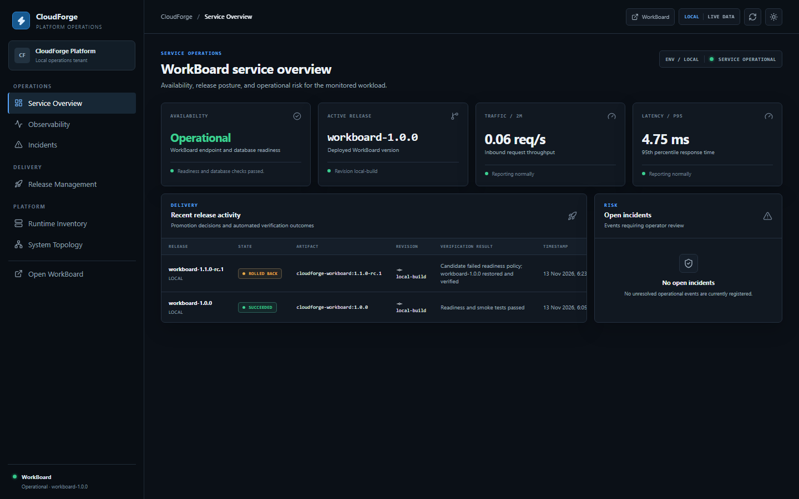
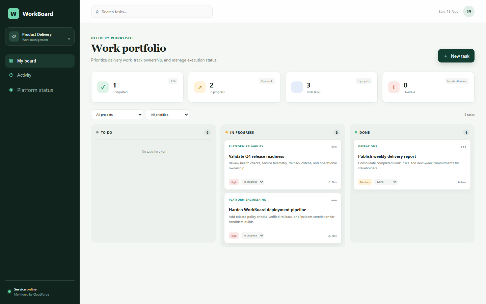
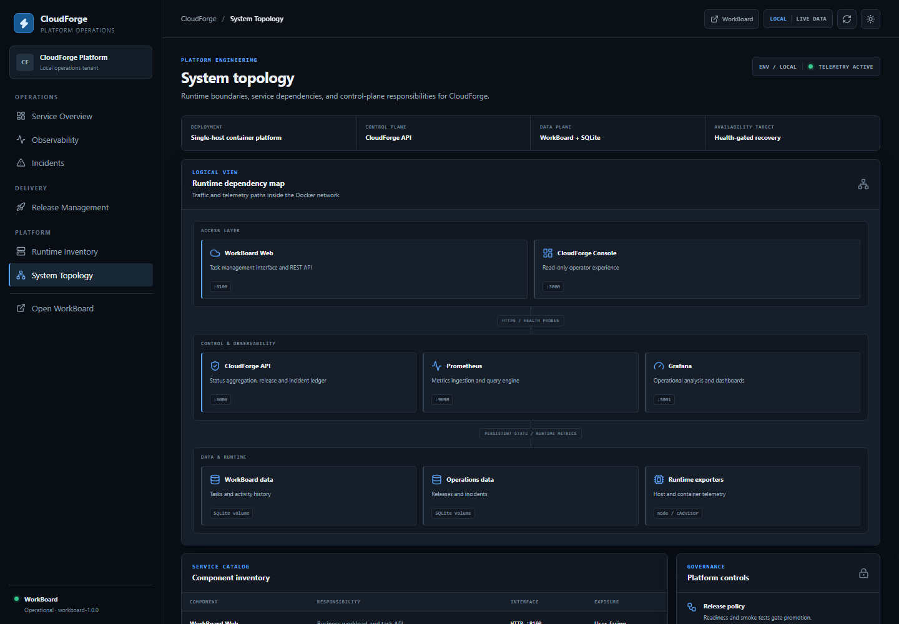
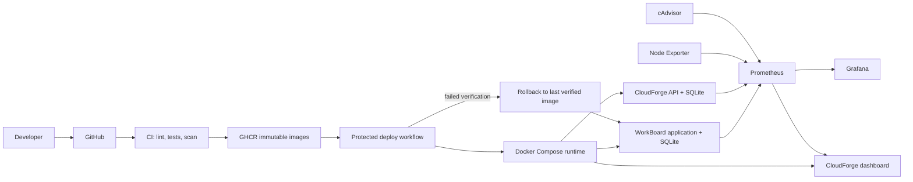

# CloudForge — Automated Cloud Infrastructure & DevOps Platform

[](https://github.com/sneha2003/cloudforge-devops-platform/actions/workflows/ci.yml)


CloudForge is an operations platform built around **WorkBoard**, a separate task-management application with persistent data. It answers the questions an operator needs during a release: Is the service ready? What version is running? Has latency changed? Did verification pass? If a candidate fails, which artifact was restored?



The complete platform runs locally as seven containers. Azure infrastructure and deployment automation are included, but this repository does not claim a live cloud environment until the credentialed deployment has been executed and recorded.

## Engineering outcomes

- Built two independently deployable applications: the WorkBoard workload and a read-only CloudForge control plane.
- Added active readiness checks, real request and latency metrics, release history, incident correlation, and container/host telemetry.
- Implemented health-gated promotion that restores the last verified image when a release candidate fails.
- Automated Python and frontend quality checks, container builds, vulnerability scanning, Terraform validation, and immutable GHCR publication.
- Documented the system as an operator would receive it: architecture, setup, monitoring, incident response, security boundaries, cloud deployment, and teardown.

## Product tour

| Monitored workload | Platform topology |
|---|---|
|  |  |

## System capabilities

- A polished WorkBoard website with projects, tasks, priorities, due dates, search, filters, progress columns, activity history, and persistent SQLite data.
- A separate FastAPI operations API with real deployment and incident history, active WorkBoard health checks, OpenAPI docs, and Prometheus queries.
- A responsive React/TypeScript console with service overview, observability, incidents, release management, runtime inventory, and system topology. The browser is read-only for privileged operations.
- Multi-stage, non-root container images and a one-command Compose stack with health-aware startup.
- Prometheus collection, real request/latency/error/resource metrics, alert rules, and a provisioned Grafana dashboard.
- An immutable-image deployment script that preserves the last verified release, runs probes and smoke tests, performs a real rollback, records the incident, and still reports failure to CI.
- Least-privilege GitHub Actions for tests, Trivy scanning, image publication to GHCR, SBOM/provenance, Terraform validation, and opt-in Azure deployment using OIDC.
- Minimal Terraform for an Ubuntu VM, VNet, subnet, restricted NSG, public IP, managed identity, and cloud-init bootstrap.

## Architecture



Privileged Docker and cloud controls stay in operator scripts and protected CI. The dashboard consumes only the documented HTTP API. See [the architecture guide](docs/architecture.md).

### Key design decisions

| Decision | Reason |
|---|---|
| Separate WorkBoard from CloudForge | Monitoring remains meaningful because the control plane is not monitoring itself. |
| Keep the browser read-only | Release, Docker, and cloud credentials never enter frontend code. |
| Promote immutable image references | A rollback restores a known artifact instead of rebuilding unknown source state. |
| Report missing telemetry honestly | The console shows unavailable data rather than manufactured charts or status. |
| Use Compose on one host | It keeps the operating model and cost proportionate; Kubernetes would add complexity without a current scaling requirement. |

## Start locally

Prerequisites: Docker Desktop with Linux containers, Docker Compose v2, Git, and roughly 4 GB free RAM.

```bash
cp .env.example .env
# Change CLOUDFORGE_OPERATOR_TOKEN and GRAFANA_ADMIN_PASSWORD in .env
docker compose up --build -d
docker compose ps
```

Open:

- **WorkBoard application:** <http://localhost:8100>
- **CloudForge health dashboard:** <http://localhost:3000>
- API documentation: <http://localhost:8000/docs>
- Grafana: <http://localhost:3001> (credentials from `.env`)
- Prometheus: <http://localhost:9090> (loopback-only; local diagnosis)

Run `docker compose down` to stop services while keeping data. Read [Getting started](docs/getting-started.md) for troubleshooting and platform notes.

## Generate visible telemetry

```bash
bash deploy/scripts/generate-load.sh http://localhost:8100 120 0.1
```

Wait 30 seconds, refresh Monitoring, and inspect the provisioned **CloudForge Operations Overview** dashboard in Grafana. These charts come from actual requests; synthetic seed metrics are not used.

## Demonstrate release and rollback

Build and verify a baseline:

```bash
docker build -t cloudforge-workboard:1.0.0 apps/sample-service
export CLOUDFORGE_OPERATOR_TOKEN=the-value-from-your-env-file
bash deploy/scripts/deploy.sh cloudforge-workboard:1.0.0 workboard-1.0.0
```

Then exercise a rejected release candidate safely. It uses the API's explicit readiness-policy gate, not a fabricated database row:

```bash
bash deploy/scripts/deploy.sh cloudforge-workboard:1.1.0-rc.1 workboard-1.1.0-rc.1 --simulate-failure
```

Expected result: readiness fails, the baseline image is restored, smoke tests confirm recovery, the deployment and incident appear in the dashboard, and the command exits non-zero because the requested release failed. Logs remain under ignored `deploy/artifacts/`. See [the incident runbook](docs/incident-runbook.md).

## Test without containers

```bash
python -m venv .venv
source .venv/bin/activate              # Windows PowerShell: .venv\Scripts\Activate.ps1
pip install -r apps/api/requirements-dev.txt
pip install -r apps/sample-service/requirements-dev.txt
PYTHONPATH=apps/api pytest apps/api/tests tests
PYTHONPATH=apps/sample-service pytest apps/sample-service/tests
ruff check apps/api
ruff check apps/sample-service

cd apps/dashboard
npm ci
npm run lint
npm test
npm run build
```

CI repeats these checks, builds both images, scans the repository with Trivy, and runs `terraform fmt`/`validate`.

## Optional Azure deployment

No Azure resource is created automatically. After checking current prices and authenticating with Azure:

```bash
cd infrastructure/terraform
cp terraform.tfvars.example terraform.tfvars
terraform init
terraform fmt -check -recursive
terraform validate
terraform plan -out cloudforge.tfplan
```

Review the plan and cost before manually deciding whether to run `terraform apply cloudforge.tfplan`. Configure GitHub OIDC and a protected `production` environment before using the manual Azure workflow. The full process, HTTPS requirements, state setup, deployment bootstrap, and teardown are in [Azure deployment](docs/azure-deployment.md).

## CI/CD lifecycle

| Workflow | Trigger | Outcome |
|---|---|---|
| `CI` | pull requests and `main` | Lint, tests, type/build, images, Trivy, Terraform validation |
| `Build and publish release images` | `main` | Immutable SHA tags in GHCR with SBOM and provenance |
| `Deploy to Azure VM` | manual dispatch + protected environment | OIDC login and Azure Run Command deployment |

The deployment workflow rejects mutable tags. A release is successful only after readiness and smoke tests pass. [CI/CD explained](docs/cicd-explained.md).

## Security posture

Containers run as non-root where supported, drop capabilities, and apply `no-new-privileges`. Operator writes require a token; dashboard traffic cannot execute Docker or Terraform. Monitoring uses an internal Docker network; local ports bind to loopback. Azure SSH rejects `0.0.0.0/0`, uses public keys, and CI uses short-lived OIDC. Remaining limitations—including single-host availability, token rotation, local HTTP, and Docker daemon trust—are documented in [Security](docs/security.md).

## Documentation map

- [Architecture](docs/architecture.md) · [Getting started](docs/getting-started.md) · [Docker explained](docs/docker-explained.md)
- [CI/CD explained](docs/cicd-explained.md) · [Terraform explained](docs/terraform-explained.md) · [Azure deployment](docs/azure-deployment.md)
- [Monitoring](docs/monitoring.md) · [Security](docs/security.md) · [Incident runbook](docs/incident-runbook.md)
- [Troubleshooting](docs/troubleshooting.md) · [Interview preparation](docs/interview-preparation.md) · [Portfolio copy](docs/portfolio.md)
- [Executed validation report](docs/validation-report.md)

## Scope and limitations

The local stack is free apart from electricity. Azure cost is driven mainly by VM uptime, managed disk, and public IPv4; prices vary by region and date. Stop/deallocate the VM when idle or destroy the reviewed resource group when finished.

The current design deliberately targets a single small host: SQLite persistence, no multi-zone failover, and brief interruption during in-place deployment. Caddy automates certificates once real DNS records exist. A production expansion would move state to a managed database, add external backups and alert routing, and introduce multiple instances only when availability requirements justify them. Azure execution remains pending until it is run in an authorized subscription.

## Repository layout

```text
apps/api                 FastAPI service, data store, metrics, tests
apps/sample-service      WorkBoard website, task API, SQLite data, metrics, tests
apps/dashboard           React/TypeScript/Tailwind operations console
deploy/scripts           Smoke, load, deployment, and rollback workflows
infrastructure           Terraform and Ubuntu cloud-init
monitoring               Prometheus alerts and Grafana provisioning
.github/workflows        CI, immutable release, optional Azure deployment
docs                     Architecture, operations, security, and portfolio guides
tests                    Cross-cutting deployment tests
```

## Next engineering milestones

Exercise the full Azure path in a controlled subscription, record cost and recovery evidence, move backups to encrypted Azure Storage, sign images with keyless Sigstore, and add Alertmanager routing against an explicit escalation policy.

Licensed under the [MIT License](LICENSE).

