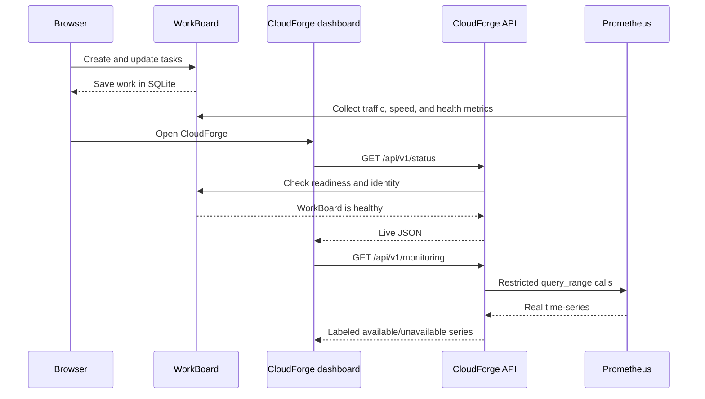

# Architecture

CloudForge monitors a separate, useful web application named WorkBoard. This makes the demonstration concrete: people use WorkBoard to manage tasks, while CloudForge checks that WorkBoard is available, fast, and safe to release.

## Runtime flow

The public dashboard does not receive a Docker socket, cloud credentials, Prometheus administration API, or operator token. A deployment is performed by `deploy/scripts/deploy.sh` from a trusted operator context. It writes metadata through token-protected API endpoints.

## Boundaries and decisions

| Component | Responsibility | Why |
|---|---|---|
| WorkBoard | Projects and task management | A real application for CloudForge to monitor and release |
| WorkBoard SQLite | Tasks and activity history | Durable application data without an unnecessary database cluster |
| CloudForge API | Active health checks, operational metadata, metrics proxy | Keeps operations separate from the product |
| CloudForge SQLite | Deployments and incidents | Durable operational history |
| React | Read-only CloudForge control room | Clear operational visualization |
| Nginx | Static app and same-origin API proxy | Small runtime and avoids browser CORS complexity |
| Prometheus | Metrics collection/query | Standard pull-based operational telemetry |
| Grafana | Deep operator visualization | Reusable, provisioned dashboards |
| Terraform | Optional Azure resources | Reviewable, reproducible infrastructure |

Availability is single-host. Replacing the API container causes a brief interruption, so CloudForge does not claim zero downtime. Azure uses one cost-conscious VM; high availability would require multiple instances, a load balancer, and an external data store.

## Source locations

WorkBoard is under `apps/sample-service`, the CloudForge API is under `apps/api/app`, the CloudForge dashboard is under `apps/dashboard/src`, runtime configuration is in `compose.yaml`, monitoring is under `monitoring`, deployment logic is under `deploy/scripts`, and cloud infrastructure is under `infrastructure`.

## Interview demonstration

Open the Architecture page, explain the trust boundary, generate a little traffic, deploy a known-good image, then trigger the forced readiness failure. Point out that recovery success and release success are different: the service recovers, but the deployment command remains failed.

