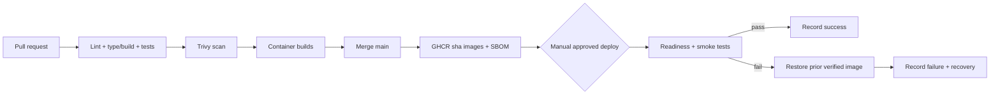

# CI/CD explained

Continuous Integration (CI) checks every proposed change. Continuous Delivery (CD) creates a releasable artifact and deploys it only under defined controls.

## CloudForge pipeline

`.github/workflows/ci.yml` has only read access. The release workflow alone can write packages. The Azure workflow has `id-token: write` for federated login and uses a protected `production` environment. Configure required reviewers in GitHub repository settings.

Images use `sha-<commit>` tags. A tag identifies exact content and supports rollback; `latest` would be ambiguous. The Azure workflow rejects inputs that do not look immutable.

To demonstrate locally, use `deploy/scripts/deploy.sh`. The same stages—previous release, new image, readiness loop, smoke test, promote or rollback—run without cloud access.

